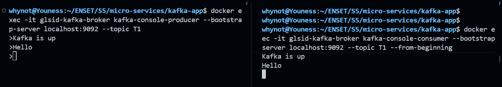
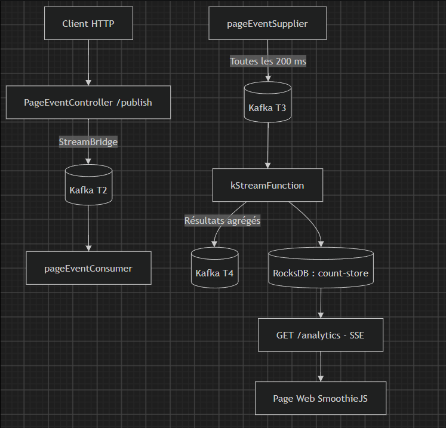

# Rapport de Travaux Pratiques : Architecture orientée événements avec Apache Kafka et Spring Cloud Stream

**Filière :** GLSID — Génie du Logiciel et des Systèmes Informatiques Distribués  
**Encadrant :** Mohamed YOUSSFI  
**Étudiant :** Youness HATTABI

---

## Table des matières

1. [Introduction](#1-introduction)
2. [Déploiement de Kafka avec Docker](#2-déploiement-de-kafka-avec-docker)
3. [Création du projet Spring Boot](#3-création-du-projet-spring-boot)
4. [Modèle d'événement — `PageEvent`](#4-modèle-dévénement--pageevent)
5. [Service Producer Kafka via REST](#5-service-producer-kafka-via-rest)
6. [Services Consumer et Supplier](#6-services-consumer-et-supplier)
7. [Traitement temps réel avec Kafka Streams](#7-traitement-temps-réel-avec-kafka-streams)
8. [API SSE et visualisation Web](#8-api-sse-et-visualisation-web)
9. [Tests et résultats](#9-tests-et-résultats)
10. [Conclusion](#10-conclusion)

---

## 1. Introduction

Les architectures orientées événements permettent aux applications de communiquer de manière asynchrone, à partir de messages décrivant des faits qui se sont produits dans le système. Contrairement à une chaîne d'appels REST synchrones, le producteur d'un événement n'a pas besoin d'attendre son traitement par chacun des services intéressés. Ce découplage facilite l'intégration de composants indépendants et la mise en place de traitements en continu.

L'objectif de ce travail pratique est de découvrir **Apache Kafka** et son intégration dans une application **Spring Boot**, au moyen de trois étapes : l'installation native de Kafka, son déploiement avec Docker, puis le développement d'un exemple complet de traitement de flux avec **Spring Cloud Stream** et **Kafka Streams**.

L'application développée simule des visites sur les pages `P1` et `P2`, publie des événements dans Kafka, compte les visites dépassant une durée minimale sur des fenêtres de cinq secondes et affiche les statistiques dans un navigateur au moyen de **Server-Sent Events (SSE)** et **SmoothieJS**.

## 2. Déploiement de Kafka avec Docker

### 2.1. Configuration Docker Compose

Pour reproduire le même scénario dans des conteneurs, un fichier `docker-compose.yml` a été créé :

```yaml
services:
  zookeeper:
    image: confluentinc/cp-zookeeper:7.3.0
    container_name: glsid-zookeeper
    environment:
      ZOOKEEPER_CLIENT_PORT: 2181
      ZOOKEEPER_TICK_TIME: 2000
    ports:
      - "2181:2181"

  kafka:
    image: confluentinc/cp-kafka:7.3.0
    container_name: glsid-kafka-broker
    depends_on:
      - zookeeper
    ports:
      - "9092:9092"
    environment:
      KAFKA_BROKER_ID: 1
      KAFKA_ZOOKEEPER_CONNECT: zookeeper:2181
      KAFKA_LISTENERS: PLAINTEXT://0.0.0.0:9092
      KAFKA_ADVERTISED_LISTENERS: PLAINTEXT://localhost:9092
      KAFKA_OFFSETS_TOPIC_REPLICATION_FACTOR: 1
```

Le paramètre `KAFKA_ADVERTISED_LISTENERS` indique l'adresse annoncée aux clients Kafka. La valeur `localhost:9092` convient ici, car l'application Spring Boot s'exécute directement sur la machine hôte.

### 2.2. Démarrage et validation

Avant le démarrage, les services Kafka et ZooKeeper exécutés nativement ont été arrêtés pour éviter les conflits de ports.

```powershell
docker compose up -d
docker ps
```

Création du topic de test :

```powershell
docker exec glsid-kafka-broker kafka-topics --create --if-not-exists --bootstrap-server localhost:9092 --topic T1 --partitions 1 --replication-factor 1
```

Consumer :

```powershell
docker exec -it glsid-kafka-broker kafka-console-consumer --bootstrap-server localhost:9092 --topic T1 --from-beginning
```

Producer :

```powershell
docker exec -it glsid-kafka-broker kafka-console-producer --bootstrap-server localhost:9092 --topic T1
```

**Résultat :** les messages envoyés depuis le Producer dans le conteneur ont été reçus par le Consumer. Le broker Docker est ensuite resté actif pour les étapes Spring Boot.



## 3. Création du projet Spring Boot

### 3.1. Initialisation

Le projet Maven `kafka-demo` est développé en **Java 21**. Il a d'abord été initialisé avec Spring Boot 4.1.1, puis ses dépendances ont été réalignées vers **Spring Boot 3.5.7** et **Spring Cloud 2025.0.0** pendant la résolution des problèmes de compatibilité.

Les principales bibliothèques utilisées sont :

| Dépendance                               | Rôle                                                                   |
| ---------------------------------------- | ---------------------------------------------------------------------- |
| Spring Web                               | Exposition des endpoints REST et SSE.                                  |
| Spring Cloud Stream Kafka Binder         | Communication avec Kafka via `Consumer`, `Supplier` et `StreamBridge`. |
| Spring Cloud Stream Kafka Streams Binder | Intégration d'une fonction basée sur `KStream`.                        |
| Spring Kafka / Kafka Streams             | Bibliothèques Kafka sous-jacentes.                                     |
| Reactor Core                             | Utilisation de `Flux` pour le flux SSE.                                |
| SmoothieJS                               | Affichage d'une courbe actualisée en continu dans le navigateur.       |

### 3.2. Structure du projet

```text
docker-compose.yml
kafka-demo/
├── pom.xml
└── src/
    └── main/
        ├── java/
        │   └── .../
        │       ├── KafkaDemoApplication.java
        │       ├── controllers/
        │       │   └── PageEventController.java
        │       ├── events/
        │       │   └── PageEvent.java
        │       └── handlers/
        │           └── PageEventHandler.java
        └── resources/
            ├── application.properties
            └── static/
                └── index.html
```

### 3.3. Architecture des échanges



Les deux parcours sont distincts : `T2` sert à valider la communication Producer/Consumer, tandis que `T3` alimente le traitement analytique. `T4` reçoit les mises à jour des agrégations et `count-store` est interrogé pour l'affichage Web.

## 4. Modèle d'événement — `PageEvent`

Le modèle est implémenté sous la forme d'un `record` Java :

```java
public record PageEvent(String name, String user, Date date, long duration) {}
```

| Champ      | Description                                    |
| ---------- | ---------------------------------------------- |
| `name`     | Page visitée (`P1` ou `P2`).                   |
| `user`     | Identifiant simulé du visiteur (`U1` ou `U2`). |
| `date`     | Date de génération de l'événement.             |
| `duration` | Durée simulée de la visite.                    |

Exemple de message JSON :

```json
{
  "name": "P1",
  "user": "U2",
  "date": "2026-10-21T18:00:00.000+00:00",
  "duration": 450
}
```

## 5. Service Producer Kafka via REST

Le contrôleur `PageEventController` expose l'endpoint `GET /publish`. Il génère un événement puis l'envoie au topic demandé à l'aide de `StreamBridge` :

```java
@GetMapping("/publish")
public PageEvent publish(@RequestParam String name, @RequestParam String topic) {
    PageEvent event = new PageEvent(
            name,
            random.nextBoolean() ? "U1" : "U2",
            new Date(),
            random.nextInt(10000) + 10
    );

    streamBridge.send(topic, event);
    return event;
}
```

**Test :** `http://localhost:8080/publish?name=P1&topic=T2`.

La réponse HTTP contient l'événement créé ; le Consumer abonné à `T2` affiche le même événement en console. L'utilisation de `GET` suit l'énoncé du TP ; pour une API métier en production, une opération de publication avec effet de bord serait généralement exposée en `POST`.

## 6. Services Consumer et Supplier

### 6.1. Consumer

Le Consumer est une fonction Java déclarée comme bean Spring :

```java
@Bean
public Consumer<PageEvent> pageEventConsumer() {
    return event -> System.out.println(event);
}
```

Son binding associe `pageEventConsumer-in-0` au topic `T2` :

```properties
spring.cloud.stream.bindings.pageEventConsumer-in-0.destination=T2
spring.cloud.stream.bindings.pageEventConsumer-in-0.group=page-event-group
```

### 6.2. Supplier

Le Supplier simule des visites aléatoires sans intervention du client :

```java
@Bean
public Supplier<PageEvent> pageEventSupplier() {
    return () -> new PageEvent(
            random.nextBoolean() ? "P1" : "P2",
            random.nextBoolean() ? "U1" : "U2",
            new Date(),
            random.nextInt(10000) + 10
    );
}
```

```properties
spring.cloud.stream.bindings.pageEventSupplier-out-0.destination=T3
spring.cloud.stream.bindings.pageEventSupplier-out-0.producer.poller.fixed-delay=200
```

Le _poller_ appelle périodiquement le Supplier, avec un délai configuré de **200 ms**. Les événements sont automatiquement envoyés vers `T3`.

## 7. Traitement temps réel avec Kafka Streams

La fonction `kStreamFunction()` consomme les événements de `T3`, filtre les visites dont la durée dépasse `100`, regroupe les résultats par page et compte les occurrences dans des **fenêtres fixes de cinq secondes** (_tumbling windows_).

```java
@Bean
public Function<KStream<String, PageEvent>, KStream<String, Long>> kStreamFunction() {
    return input -> input
            .filter((key, event) -> event.duration() > 100)
            .map((key, event) -> new KeyValue<>(event.name(), 0L))
            .groupBy((key, value) -> key,
                    Grouped.with(Serdes.String(), Serdes.Long()))
            .windowedBy(TimeWindows.ofSizeWithNoGrace(Duration.ofSeconds(5)))
            .count(Materialized.as("count-store"))
            .toStream()
            .map((windowedKey, count) ->
                    new KeyValue<>(windowedKey.key(), count));
}
```

| Opération         | Résultat                                                                |
| ----------------- | ----------------------------------------------------------------------- |
| `filter`          | Ignore les événements avec `duration <= 100`.                           |
| `map`             | Utilise le nom de la page comme clé de regroupement.                    |
| `groupBy`         | Regroupe les événements par page.                                       |
| `windowedBy`      | Répartit les événements en fenêtres non chevauchantes de cinq secondes. |
| `count`           | Calcule le nombre de visites par page et par fenêtre.                   |
| `Materialized.as` | Stocke les comptes dans un état local nommé `count-store`.              |
| `toStream`        | Convertit les mises à jour agrégées en flux publié vers `T4`.           |

Kafka Streams utilise **RocksDB** comme stockage d'état local et peut restaurer cet état à partir de données internes de Kafka. Les messages publiés sur `T4` correspondent à des **mises à jour de comptes**, et non obligatoirement à une seule valeur finale par fenêtre.

Configuration essentielle :

```properties
spring.cloud.function.definition=pageEventConsumer;pageEventSupplier;kStreamFunction
spring.cloud.stream.bindings.kStreamFunction-in-0.destination=T3
spring.cloud.stream.bindings.kStreamFunction-out-0.destination=T4
spring.cloud.stream.kafka.streams.binder.functions.kStreamFunction.applicationId=page-analytics-app
spring.cloud.stream.kafka.streams.binder.configuration.commit.interval.ms=1000
```

## 8. API SSE et visualisation Web

### 8.1. Endpoint `/analytics`

L'endpoint SSE interroge périodiquement le magasin `count-store` grâce à `InteractiveQueryService` :

```java
@GetMapping(path = "/analytics", produces = MediaType.TEXT_EVENT_STREAM_VALUE)
public Flux<Map<String, Long>> analytics() {
    return Flux.interval(Duration.ofSeconds(1))
            .map(sequence -> {
                Map<String, Long> results = new HashMap<>();
                Map<String, Long> latestWindows = new HashMap<>();
                ReadOnlyWindowStore<String, Long> store =
                        interactiveQueryService.getQueryableStore(
                                "count-store", QueryableStoreTypes.windowStore());

                Instant now = Instant.now();
                try (KeyValueIterator<Windowed<String>, Long> iterator =
                             store.fetchAll(now.minusSeconds(5), now)) {
                    while (iterator.hasNext()) {
                        var entry = iterator.next();
                        String page = entry.key.key();
                        long windowStart = entry.key.window().start();
                        if (!latestWindows.containsKey(page)
                                || windowStart > latestWindows.get(page)) {
                            latestWindows.put(page, windowStart);
                            results.put(page, entry.value);
                        }
                    }
                }
                return results;
            });
}
```

Le serveur envoie un événement SSE environ chaque seconde, sous une forme comparable à :

```text
data:{"P1":4,"P2":6}
```

La consultation repose sur les fenêtres **dont le début appartient à la plage interrogée**. Il s'agit de statistiques issues de fenêtres fixes, et non d'un véritable calcul de fenêtre glissante en continu.

### 8.2. Tableau de bord SmoothieJS

L'interface est placée dans `src/main/resources/static/index.html`. Le navigateur établit une connexion SSE avec l'API :

```javascript
const eventSource = new EventSource("/analytics");

eventSource.onmessage = function (event) {
  const data = JSON.parse(event.data);
  const time = Date.now();

  for (const page in pages) {
    pages[page].append(time, data[page] ?? 0);
  }
};
```

L'objet `SmoothieChart` anime les séries correspondant aux pages `P1` et `P2`. Une fois la connexion ouverte, les mises à jour arrivent sans rechargement de la page.

**Interface :** `http://localhost:8080/index.html`.


## 9. Tests et résultats

### 9.1. Procédure de lancement

```powershell
# Dans le répertoire du compose
docker compose up -d

# Dans le répertoire Maven du projet
.\mvnw.cmd spring-boot:run
```

### 9.2. Vérification des différentes fonctionnalités

| Test            | Action                                      | Résultat obtenu                            |
| --------------- | ------------------------------------------- | ------------------------------------------ |
| Kafka natif     | Console Producer vers Consumer sur `T1`     | Messages transmis avec succès.             |
| Kafka Docker    | `docker exec` Producer et Consumer sur `T1` | Communication validée dans les conteneurs. |
| Producer REST   | `GET /publish?name=P1&topic=T2`             | Événement JSON renvoyé et publié.          |
| Consumer Spring | Observer les journaux de l'application      | Événement de `T2` affiché.                 |
| Supplier        | Consommer `T3` depuis la CLI                | Production continue d'événements.          |
| Kafka Streams   | Consommer `T4` avec un désérialiseur `Long` | Comptes de visites `P1`/`P2` reçus.        |
| SSE             | Consulter `/analytics`                      | Flux de données envoyé périodiquement.     |
| Application Web | Consulter `/index.html`                     | Courbes actualisées en temps réel.         |

Commande de vérification des résultats sur `T4` :

```powershell
docker exec -it glsid-kafka-broker kafka-console-consumer --bootstrap-server localhost:9092 --topic T4 --property print.key=true --property print.value=true --property key.deserializer=org.apache.kafka.common.serialization.StringDeserializer --property value.deserializer=org.apache.kafka.common.serialization.LongDeserializer
```

## 10. Conclusion

Ce travail pratique a permis de mettre en œuvre une architecture orientée événements en partant des mécanismes fondamentaux de Kafka jusqu'au traitement et à la visualisation de flux en temps réel. Les tests natifs et conteneurisés ont validé la communication entre producteurs et consommateurs, tandis que **Spring Cloud Stream** a simplifié le raccordement des fonctions Java aux topics Kafka.

L'intégration de **Kafka Streams** a illustré les opérations de filtrage, de regroupement et de comptage sur fenêtres temporelles, ainsi que l'intérêt des magasins d'état locaux. Enfin, l'association de **SSE** et **SmoothieJS** a permis de restituer les agrégations dans une interface Web mise à jour automatiquement.

---
